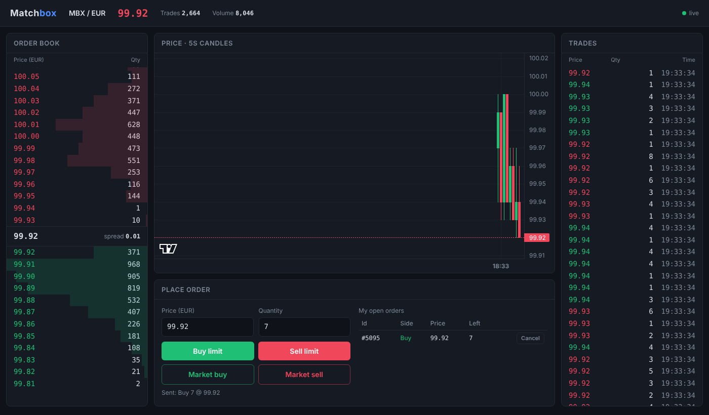
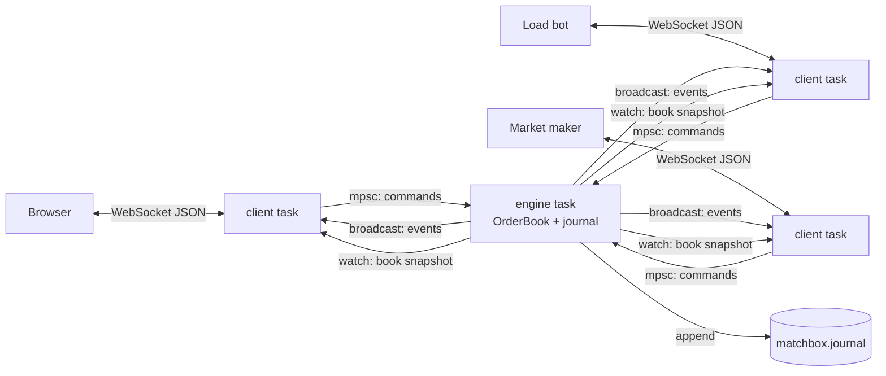

# Matchbox


**A single-threaded exchange matching engine in Rust, with a WebSocket API, a command journal and a live order book in the browser.**

🔗 **Live demo:** <!-- TODO: paste the Render URL here --> `https://<your-app>.onrender.com` (free tier: the first visit after a quiet period takes about a minute to wake up)



Matchbox is a small exchange built from scratch: an order book that matches buy and sell orders by **price–time priority**, a server that lets any number of clients trade over WebSocket, bots that keep the market alive, and a web page that shows everything in real time. You can place, match and cancel orders yourself in the browser.

## Highlights

- **Matching engine** — limit and market orders, partial fills, sweeps across several price levels, cancellation through an order index (no scan over the whole book).
- **Deterministic core** — the engine is a pure function `Command → Vec<Event>`: no clocks, no I/O, no threads inside. Same commands in, same book out.
- **Command journal** — every command is appended to a JSON Lines file *before* it is applied; on startup the book is rebuilt by replaying the journal.
- **Tested** — 31 tests: unit tests for every scenario, plus **property-based tests** (proptest) that run hundreds of random command sequences and check book invariants after every single command.
- **Measured** — Criterion throughput benchmark and per-command latency percentiles; one optimization driven by those numbers (**p99 −15×**).
- **Live UI** — order book with depth bars, 5-second candle chart, trade tape, order form and "my orders" with cancel.

## Architecture



| Crate | Role |
|---|---|
| `engine/` | Library: domain types, order book, matching, journal, workload generator. No async, no networking. |
| `server/` | Axum + Tokio. One task per client; **one** task owns the order book. Serves the web page. |
| `bots/` | `bots` — load generator (random orders around a drifting price). `market_maker` — keeps two-sided quotes. |
| `web/` | Single `index.html`: plain JavaScript, WebSocket, [lightweight-charts](https://github.com/tradingview/lightweight-charts). |

### How a command flows

1. A client sends `{"type":"Limit","side":"Buy","price":10005,"qty":3}`.
2. Its task assigns a unique order id and pushes the command into an **mpsc** queue.
3. The engine task takes commands one at a time: **append to the journal → `book.process(cmd)`**.
4. Resulting events (`Accepted`, `Trade`, `Cancelled`, `Rejected`) go out to every client via **broadcast**; the new top of book goes out via **watch** (only the latest snapshot matters, slow clients just skip stale ones).

## Design decisions (and why)

- **Single-threaded engine (LMAX style).** All commands go through one queue to one task. No locks, no races, and the outcome depends only on the order of commands, which makes the journal and replay possible. Concurrency lives at the edges (network I/O), not in the matching logic.
- **Integer prices and quantities (`u64` ticks), never floats.** `0.1 + 0.2 != 0.3` in floating point; prices must compare exactly and money must add up. The UI converts ticks to EUR only for display.
- **Newtypes for `Price`, `Qty`, `OrderId`.** They are all `u64` at runtime, but the compiler refuses to mix them up (`Price + Qty` doesn't compile).
- **Order book layout.** `BTreeMap<Price, Level>` per side keeps prices sorted (best bid = last key, best ask = first key); each `Level` is a `VecDeque<Order>` for FIFO within a price; a `HashMap<OrderId, (Side, Price)>` index finds an order's level directly for cancellation.
- **Trades execute at the maker's price.** A buyer willing to pay 105 who hits an ask at 101 trades at 101 (price improvement for the taker).
- **Market orders are IOC.** They match whatever is available and the unfilled rest is cancelled; a market order never rests in the book (it has no price to rest at).
- **Write-ahead journal.** A command is written to disk before it changes the book, so a crash can't lose a command that already had an effect. A torn last line from a crash mid-write is ignored on replay.

## Invariants checked by property tests

After **every** command in hundreds of random sequences (limit, market, cancel, duplicate ids, zero quantities, crossing prices):

1. the book is never crossed: best bid < best ask;
2. no empty price levels;
3. no resting order with zero quantity;
4. every order sits on its own side and price level;
5. the index knows every resting order with the right side and price;
6. each level's cached total equals the sum of its orders;
7. the index has no stale entries.

## Performance

Release build, Windows laptop. Workload: deterministic mix of ~60% limit orders (some crossing), ~15% market orders, ~25% cancels.

| Metric | Value |
|---|---|
| Throughput (Criterion, 100k mixed commands) | **~4.3 M commands/s** |
| Latency p50 | **200 ns** |
| Latency p99 | **700 ns** |
| Latency p99.9 | **1.8 µs** |

### Optimization: cancel search from the back

The first latency run showed p50 = 200 ns but **p99 = 10.4 µs**. Splitting latency by command type pointed at cancels: with long queues per price level, finding the order to cancel scanned the queue from the front. Cancels mostly hit *recent* orders, which sit at the *back* of the queue — so the search now starts from the back (`rposition` instead of `position`).

| | before | after |
|---|---|---|
| mean | 726 ns | 257 ns |
| p99 | 10.4 µs | **0.7 µs** (−15×) |
| p99.9 | 22.9 µs | 1.8 µs |

Worst case is still O(n) in the level length; a fully O(1) cancel (intrusive linked list in a slab) is on the roadmap.

## Run it locally

Requires Rust (stable).

```bash
# terminal 1: the exchange (http://localhost:3000)
cargo run -p server

# terminal 2: random order flow, 150 orders/s
cargo run -p bots --release -- 150

# terminal 3 (optional): market maker
cargo run -p bots --release --bin market_maker
```

Open **http://localhost:3000**. Stop the server and start it again — the book is restored from `matchbox.journal` (delete the file to start fresh).

Other entry points:

```bash
cargo test --workspace                                  # unit + property tests
cargo bench -p engine                                   # Criterion throughput
cargo run -p engine --release --example latency         # p50 / p99 / p99.9
cargo run -p engine --example cli                       # play with the engine in the terminal
```

### WebSocket API

Client → server:

```json
{"type":"Limit","side":"Buy","price":10005,"qty":3}
{"type":"Market","side":"Sell","qty":2}
{"type":"Cancel","id":42}
```

Server → client: `Snapshot` (top 20 levels per side), `Assigned` (your new order id), `Accepted`, `Trade`, `Cancelled`, `Rejected`, `Error`. Prices are integer ticks (1 tick = 0.01 EUR).

## Deployment

The `Dockerfile` builds the server and both bots; `start.sh` runs all three, so the public demo has a live market on its own. Deployed on Render (free tier). The server reads its port from `PORT`; bots read the server address from `MATCHBOX_URL`.

## Roadmap

- O(1) cancel: orders in a slab with an intrusive doubly-linked list per level.
- Journal snapshots, so startup doesn't replay the full history.
- More order types: FOK/IOC limit, post-only, stop orders, modify/replace.
- Multiple instruments (one book per symbol), accounts and balances.
- Metrics (Prometheus) and a network-level load test.

## How it was built

Built in three days as a portfolio project while learning Rust (coming from C++). I wrote the engine core myself — order book, matching, market orders, cancellation, journal, invariant checks — using Claude as a tutor and code reviewer. The server, bots, web page and deployment were generated with AI assistance and then integrated, tested and reviewed by me, so I could focus my time on the engine and the architecture.

## License

MIT
